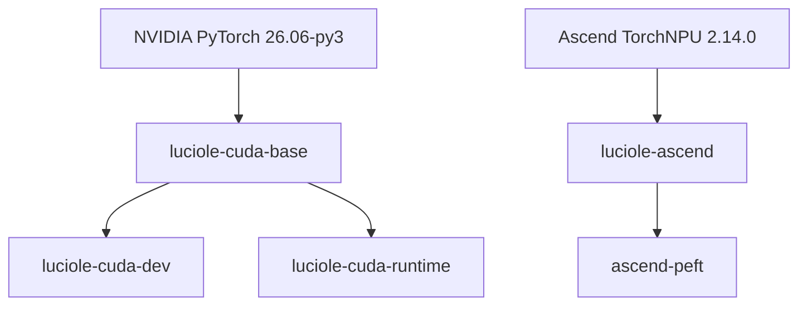
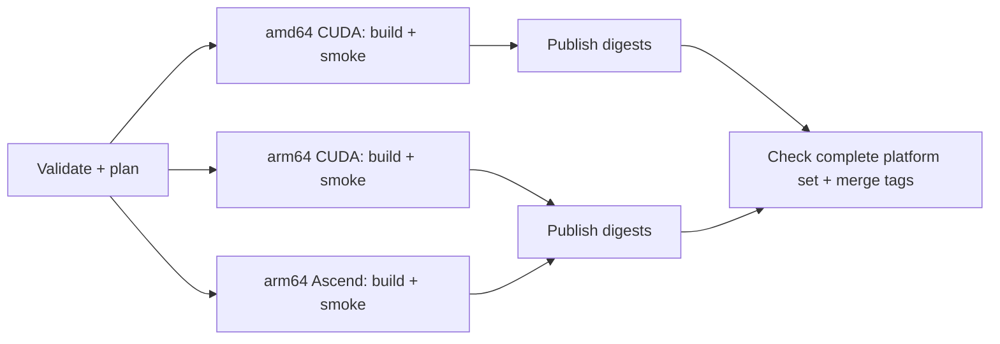

# DKUAV Images

Docker images for DKUAV / Luciole, published to `ghcr.io/dkuav/<image>`.

> 中文文档：[README_zh.md](README_zh.md)

## Images



| Image | Contents | Platforms | Smoke policy |
| --- | --- | --- | --- |
| [luciole-cuda-base](src/luciole-cuda-base/README.md) | PyTorch/CUDA, system and GUI tools, Python packages, CMake, networking libraries, user and SSH setup | amd64 + arm64 | Advisory |
| [luciole-cuda-dev](src/luciole-cuda-dev/README.md) | Base + ROS 2 Jazzy, LLVM 21, developer shell, cached pre-commit hooks | amd64 + arm64 | Required |
| [luciole-cuda-runtime](src/luciole-cuda-runtime/README.md) | Base + ROS 2 Jazzy; inherits system development tools and CMake | amd64 + arm64 | Required |
| [luciole-ascend](src/luciole-ascend/README.md) | Ascend 910B TorchNPU, CANN and ARM64 development tools | arm64 | Required |
| [ascend-peft](src/ascend-peft/README.md) | Ascend base + PEFT dependencies and Graphviz/torchview model visualization | arm64 | Required |

The CUDA base and Ascend image keep upstream package sources. CUDA dev/runtime switch persisted apt and pip sources to Aliyun after all package installation. The runtime image inherits the base toolset; it is not a minimal CUDA runtime image. Ascend uses a tagged external base without a pinned digest; run its separate NPU check on a compatible host.

CUDA and Ascend use the same Python development requirements for tools such as uv, ty and Ruff, plus setuptools, Hatchling, hatch-vcs and editables for Python builds and editable installs. Their pip installers retain CUDA-specific vision packages and Ascend vendor constraints separately.

## Use an image

```bash
docker pull ghcr.io/dkuav/luciole-cuda-dev:pytorch26.06-py3
docker run --rm -it --gpus all ghcr.io/dkuav/luciole-cuda-dev:pytorch26.06-py3
```

CUDA base and Ascend default to root; CUDA dev/runtime default to `luciole` (UID/GID 1000). Ascend uses `/root` as HOME so the vendor CANN environment can be read. The shared entrypoint starts sshd according to `SSH_MODE` and executes the command as the Dockerfile's `USER`. CUDA defaults to password mode; Ascend defaults to key-only SSH and requires a nonempty `/root/.ssh/authorized_keys`. Explicit root password SSH requires a runtime-mounted password file. Key-only mode requires a nonempty authorized-keys file, and `SSH_MODE=disabled` starts no SSH server. CUDA dev/runtime prohibit root SSH by default. `APP_USER` is CUDA metadata, not an identity switch. See the image guides for SSH and Compose examples.

## Local build and smoke tests

After syncing development dependencies, install the Git hook in this repository and optionally check every file:

```bash
uv sync --locked --extra dev
uv run --no-sync pre-commit install
uv run --no-sync pre-commit run --all-files
```

The hooks run basic file checks, Ruff fixes and formatting, and a full-project ty check. Ruff and ty use the locked project development environment; the first run of the basic hooks requires network access. Consumer hooks skip `vendor/`; install and run image-kit's hooks separately in the component repository.

Build tooling comes from the pinned `vendor/image-kit` package. This repository uses schema v2 and explicit variants, preserving image names, native platforms and publication tags. Local `tools/` contains Luciole policy checks and compatibility imports. Documents in `docs/` are English; root and image READMEs are maintained in English and Chinese.

Install uv and Python 3.11+ tooling and use a Docker daemon capable of Linux containers with Buildx. The following examples use Bash; on PowerShell activate the virtual environment with `.venv\Scripts\Activate.ps1` and obtain the revision with `$revision = git rev-parse HEAD`.

```bash
git submodule update --init --recursive
uv sync --locked --extra dev
source .venv/bin/activate
python -m image_kit validate
python -m tools.check_repository
python -m image_kit list

python -m image_kit plan --target luciole-cuda-dev/pytorch26.06-py3 --output build-plan.json
revision=$(git rev-parse HEAD)
python -m image_kit bake --plan build-plan.json --owner dkuav \
  --repository dkuav/images --revision "$revision" --platform linux/amd64 \
  --mode load --output docker-bake.load.json
docker buildx bake --file docker-bake.load.json
python -m image_kit test --plan build-plan.json --owner dkuav \
  --revision "$revision" --platform linux/amd64
```

Use `linux/arm64` on an ARM64 host. Selecting dev builds and tests the current checkout's base too, without selecting base for publication. Use `plan --all` to select every image or `plan --base <git-sha> --head <git-sha>` for change detection. Run the commands from the repository root.

Existing CUDA compatibility entry points remain available:

```bash
cd src/luciole-cuda-dev
docker compose build
# Or from the repository root:
docker build -f src/luciole-cuda-dev/Dockerfile -t luciole-cuda-dev .
```

Direct Docker/Compose builds of a final image use the published base by default. Use the manifest/Bake route above when validating the current checkout's complete dependency graph. Ascend Compose only runs published images; see its [runtime setup](src/luciole-ascend/README.md#running-with-an-npu). Generated plans and Bake files are ignored by Git.

## Build configuration and CI

Each image directory has an `image.yml`. YAML declares configuration, dependencies and smoke policy; Dockerfiles define execution order; shared scripts implement installation. Python validates the contracts and emits a versioned plan and native-platform Bake graph.



- PRs build affected images and dependencies on native amd64/arm64 runners, without registry login, pushes or cache writes. Documentation-only PRs run static validation and skip builds.
- Each native worker frees unused hosted-runner SDKs and preloaded Docker images before creating Buildx, limits BuildKit to one concurrent build step, and reports disk usage even on failure. The NVIDIA base, build cache and locally loaded smoke-test images all need disk space.
- Main publishes affected targets. Manual dispatch selects all targets, a YAML image name or an exact name/variant. A separate manual release promotes a verified main run without rebuilding.
- Tags use `<variant>`, `<variant>-<sha12>-<run-id>-<attempt>` and optional `<variant>-vMAJOR.MINOR.PATCH`. Only main advances variant channels; build/version tags cannot be overwritten. Old global aliases are no longer updated.
- base assertion failures are reported; dev/runtime assertion failures block publication. Build, Docker execution and missing-script errors always fail. Final tags advance only after every native worker succeeds and all expected digests exist.
- Shared inputs trigger their consumers and downstream dependents. Smoke inputs also trigger validation. README/Compose changes do not rebuild images; tooling/schema/workflow changes rebuild all images.

See [build architecture](docs/build-architecture.md), [manifest reference](docs/manifest-reference.md), and [the workflow](.github/workflows/publish-images.yml). Tag-following upstream bases can change between builds; pin an image digest when a fixed artifact is required.

## Add or change an image

1. Add a lowercase, hyphenated image directory, Dockerfile, `image.yml`, Compose configuration and bilingual READMEs.
2. Declare its base, platforms, build arguments, each copied shared file and smoke contract in the manifest. No workflow matrix edit is needed.
3. Keep independent scripts in adjacent `COPY + RUN` pairs. Add the smoke script under `src/_tests` and declare the shared helper as an input.
4. Run `python -m image_kit validate`, `python -m tools.check_repository`, `python -m pytest`, `python -m pytest vendor/image-kit/tests`, and native builds/tests for affected platforms.

Current OpenCV replacement is disabled. The CUDA base smoke test requires CMake to resolve an apt-owned OpenCV configuration, then compiles and runs a C++ probe to check matching CMake, header and runtime versions. It does not pin a historical Ubuntu OpenCV version. Historical [OpenCV analysis](docs/opencv-status.md) and [linker diagnostics](docs/ld-cache-notes.md) retain their original evidence; they do not certify current image behavior.

## Shared component

Initialize `vendor/image-kit` before validation or builds:

```bash
git submodule update --init --recursive
```

Fresh clones can use `git clone --recurse-submodules`. Keep the component pinned to a reviewed commit; CI initializes that commit and never follows a moving branch. Shared scripts, entrypoints, pre-commit configuration and Python development requirements come from the component. Luciole adds `landscape-common` locally; `gosu` and `sudo` are shared. CUDA combines the common requirements with `src/_assets/luciole-cuda-requirements.txt`, retaining `numpy<2.0.0` and vision packages. Ruff supplies Python linting and formatting; black is no longer explicitly installed or required.

This repository uses image-kit's unified v2 schema and build engine, retaining dual-platform CUDA builds, smoke gates and existing publication tags. `tools/images` provides compatibility imports and Luciole policies. See the [migration and consumer compatibility notes](docs/image-kit-migration.md). Component pin and `.gitmodules` changes rebuild all images. Commit and publish component changes before updating the consumer pin.

Publication uses YAML `name` independently of the directory and explicit variant channels. Verified build tags are `<variant>-<sha12>-<run-id>-<attempt>`; formal `<variant>-vMAJOR.MINOR.PATCH` tags promote an existing successful main publication receipt. All required native workers must pass before public tags advance. Historical tags remain available.

CI assigns one worker to each independent dependency component and native platform. Each worker retains internal parents, passes the generated `--component`, and uses `worker_id` in artifact names. Final merge checks the complete original plan across all workers. After digest export, `test --metadata` pulls the immutable published images and repeats smoke tests, so a second Bake solve cannot publish untested content through public tags. This may download additional image layers. Collection then resolves the published native manifest and compares its config digest with the loaded smoke-test image; it does not require optional Buildx config-digest metadata.
