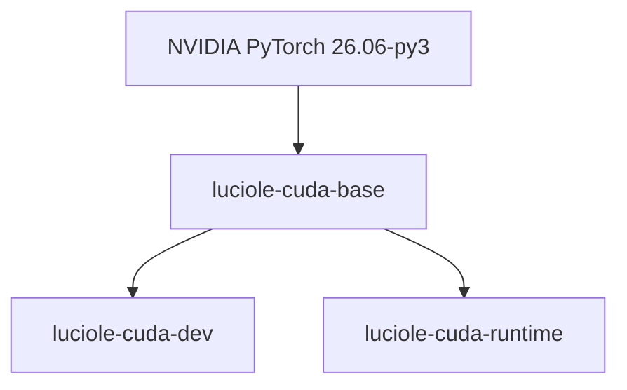
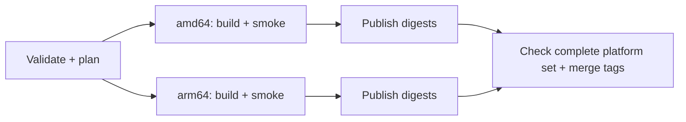

# DKUAV Images

Docker images for DKUAV / Luciole, published to `ghcr.io/dkuav/<image>`.

> 中文文档：[README_zh.md](README_zh.md)

## Images



| Image | Contents | Platforms | Smoke policy |
| --- | --- | --- | --- |
| [luciole-cuda-base](src/luciole-cuda-base/README.md) | PyTorch/CUDA, system and GUI tools, Python packages, CMake, networking libraries, user and SSH setup | amd64 + arm64 | Advisory |
| [luciole-cuda-dev](src/luciole-cuda-dev/README.md) | Base + ROS 2 Jazzy, LLVM 21, developer shell, cached pre-commit hooks | amd64 + arm64 | Required |
| [luciole-cuda-runtime](src/luciole-cuda-runtime/README.md) | Base + ROS 2 Jazzy; inherits system development tools and CMake | amd64 + arm64 | Required |

The base keeps upstream package sources. Dev/runtime switch persisted apt and pip sources to Aliyun after all package installation. The runtime image inherits the base toolset; it is not a minimal CUDA runtime image.

## Use an image

```bash
docker pull ghcr.io/dkuav/luciole-cuda-dev:latest
docker run --rm -it --gpus all ghcr.io/dkuav/luciole-cuda-dev:latest
```

Base defaults to root; dev/runtime default to `luciole` (UID/GID 1000). Their entrypoint starts sshd through sudo, then executes the command as the Dockerfile's `USER`. `APP_USER` is metadata and does not select an identity. Use `docker run --user root` when root is needed. See the image guides for SSH and Compose examples.

## Local build and smoke tests

Install Python 3.11+ tooling and use a Docker daemon capable of Linux containers with Buildx. The following examples use Bash; on PowerShell activate the virtual environment with `.venv\Scripts\Activate.ps1` and obtain the revision with `$revision = git rev-parse HEAD`.

```bash
python -m venv .venv
source .venv/bin/activate
python -m pip install -e '.[dev]'
python -m tools.images validate
python -m tools.images list

python -m tools.images plan --image luciole-cuda-dev --output build-plan.json
revision=$(git rev-parse HEAD)
python -m tools.images bake --plan build-plan.json --owner dkuav \
  --repository dkuav/images --revision "$revision" --platform linux/amd64 \
  --mode load --output docker-bake.load.json
docker buildx bake --file docker-bake.load.json
python -m tools.images test --plan build-plan.json --owner dkuav \
  --revision "$revision" --platform linux/amd64
```

Use `linux/arm64` on an ARM64 host. Selecting dev builds and tests the current checkout's base too, without selecting base for publication. Use `plan --all` to select every image or `plan --base <git-sha> --head <git-sha>` for change detection. Run the commands from the repository root.

Existing compatibility entry points remain available:

```bash
cd src/luciole-cuda-dev
docker compose build
# Or from the repository root:
docker build -f src/luciole-cuda-dev/Dockerfile -t luciole-cuda-dev .
```

Direct Docker/Compose builds of a final image use the published base by default. Use the manifest/Bake route above when validating the current checkout's complete dependency graph. Generated plans and Bake files are ignored by Git.

## Build configuration and CI

Each image directory has an `image.yml`. YAML declares configuration, dependencies and smoke policy; Dockerfiles define execution order; shared scripts implement installation. Python validates the contracts and emits a versioned plan and native-platform Bake graph.



- PRs build affected images and dependencies on native amd64/arm64 runners, without registry login, pushes or cache writes. Documentation-only PRs run static validation and skip builds.
- Each native worker frees unused hosted-runner SDKs and preloaded Docker images before creating Buildx, limits BuildKit to one concurrent build step, and reports disk usage even on failure. The NVIDIA base, build cache and locally loaded smoke-test images all need disk space.
- Pushes to main publish affected images; `v*` tag pushes build all images. Manual dispatch selects one image or all images, with all declared platforms.
- Main publishes `latest`, `main`, and `sha-<7-character-sha>`. Version-tag events publish the version tag and SHA tag. Manual runs on other branches publish only SHA tags.
- base assertion failures are reported; dev/runtime assertion failures block publication. Build, Docker execution and missing-script errors always fail. Final tags advance only after every native worker succeeds and all expected digests exist.
- Shared inputs trigger their consumers and downstream dependents. Smoke inputs also trigger validation. README/Compose changes do not rebuild images; tooling/schema/workflow changes rebuild all images.

See [build architecture](docs/build-architecture.md), [manifest reference](docs/manifest-reference.md), and [the workflow](.github/workflows/publish-images.yml). Tag-following upstream bases can change between builds; pin an image digest when a fixed artifact is required.

## Add or change an image

1. Add a lowercase, hyphenated image directory, Dockerfile, `image.yml`, Compose configuration and bilingual READMEs.
2. Declare its base, platforms, build arguments, each copied shared file and smoke contract in the manifest. No workflow matrix edit is needed.
3. Keep independent scripts in adjacent `COPY + RUN` pairs. Add the smoke script under `src/_tests` and declare the shared helper as an input.
4. Run `python -m tools.images validate`, `python -m pytest`, and native builds/tests for affected platforms.

Current OpenCV replacement is disabled; existing OpenCV assertions remain in place and may expose upstream differences. Historical [OpenCV analysis](docs/opencv-status.md) and [linker diagnostics](docs/ld-cache-notes.md) retain their original evidence; they do not certify current image behavior.
