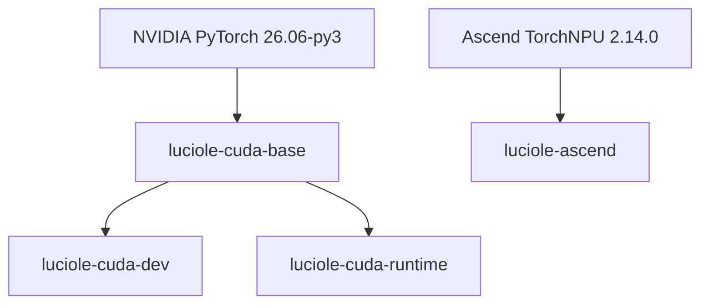
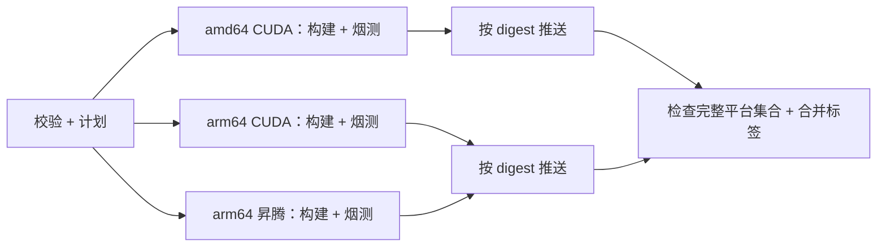

# DKUAV Images

DKUAV / Luciole 的 Docker 镜像仓库，发布地址为 `ghcr.io/dkuav/<image>`。

> English documentation: [README.md](README.md)

## 镜像



| 镜像 | 内容 | 平台 | 烟测策略 |
| --- | --- | --- | --- |
| [luciole-cuda-base](src/luciole-cuda-base/README_zh.md) | PyTorch/CUDA、系统与 GUI 工具、Python 包、CMake、网络库、用户和 SSH 配置 | amd64 + arm64 | 仅报告断言失败 |
| [luciole-cuda-dev](src/luciole-cuda-dev/README_zh.md) | Base + ROS 2 Jazzy、LLVM 21、开发 shell、预缓存 pre-commit hooks | amd64 + arm64 | 必须通过 |
| [luciole-cuda-runtime](src/luciole-cuda-runtime/README_zh.md) | Base + ROS 2 Jazzy；继承系统开发工具与 CMake | amd64 + arm64 | 必须通过 |
| [luciole-ascend](src/luciole-ascend/README_zh.md) | 昇腾 910B TorchNPU、CANN 和 ARM64 开发工具 | arm64 | 必须通过 |

CUDA base 和昇腾镜像保持上游软件源。CUDA dev/runtime 在安装完所有软件包后，将持久化的 apt 和 pip 源切换到 Aliyun。Runtime 继承 base 的工具集，并非精简 CUDA runtime 镜像。昇腾基础镜像使用版本标签但不固定 digest；NPU 硬件检查需在兼容宿主机单独运行。

CUDA 与昇腾共用 Python 开发依赖清单，包括 uv、ty 和 Ruff 等基础工具；两侧的 pip 安装脚本分别处理 CUDA 专属视觉包和昇腾厂商约束。

## 使用镜像

```bash
docker pull ghcr.io/dkuav/luciole-cuda-dev:pytorch26.06-py3
docker run --rm -it --gpus all ghcr.io/dkuav/luciole-cuda-dev:pytorch26.06-py3
```

CUDA base 和昇腾镜像默认以 root 运行；CUDA dev/runtime 默认为 `luciole`（UID/GID 1000）。昇腾使用 `/root` 作为 HOME，以读取厂商 CANN 环境。共享入口脚本根据 `SSH_MODE` 启动 sshd，再以 Dockerfile 的 `USER` 执行命令。CUDA 默认使用 password 模式；昇腾默认使用 key-only SSH，要求非空的 `/root/.ssh/authorized_keys`。显式启用 root 密码 SSH 时必须在运行时挂载密码文件。公钥模式要求非空公钥文件，`SSH_MODE=disabled` 不启动 SSH 服务。CUDA dev/runtime 默认禁止 root SSH。`APP_USER` 只是 CUDA 描述性元数据。SSH 和 Compose 示例见各镜像文档。

## 本地构建与烟测

同步开发依赖后，在当前仓库安装 Git 提交检查，并可手动检查全部文件：

```bash
uv sync --locked --extra dev
uv run --no-sync pre-commit install
uv run --no-sync pre-commit run --all-files
```

这些检查包括基础文件检查、Ruff 自动修复与格式化，以及整个项目的 ty 类型检查。Ruff 和 ty 使用项目锁定的开发环境；首次运行基础 hooks 需要网络。消费仓库跳过 `vendor/`，image-kit 的 hooks 在组件仓库中单独安装和运行。

构建工具由固定版本的 `vendor/image-kit` 包提供。本仓库使用 v2 schema 和显式 variant，保留镜像名称、原生平台和发布标签。`tools/` 只保留 Luciole 仓库规则检查和兼容入口。`docs/` 仅用英文，根目录及镜像 README 保持中英双语。

安装 uv 和 Python 3.11+ 工具，并准备支持 Linux 容器和 Buildx 的 Docker 引擎。以下示例使用 Bash；PowerShell 使用 `.venv\Scripts\Activate.ps1` 激活环境，并用 `$revision = git rev-parse HEAD` 获取提交号。

```bash
git submodule update --init --recursive
uv sync --locked --extra dev
source .venv/bin/activate
python -m image_kit validate
python -m tools.check_repository
python -m image_kit list

python -m image_kit plan --target luciole-cuda-dev/pytorch26.06-py3 --output build-plan.json
revision=$(git rev-parse HEAD)
python -m image_kit bake --plan build-plan.json --owner dkuav \
  --repository dkuav/images --revision "$revision" --platform linux/amd64 \
  --mode load --output docker-bake.load.json
docker buildx bake --file docker-bake.load.json
python -m image_kit test --plan build-plan.json --owner dkuav \
  --revision "$revision" --platform linux/amd64
```

ARM64 宿主机改用 `linux/arm64`。选择 dev 时也会构建和测试当前工作区的 base，但不会将 base 加入发布集合。`plan --all` 选择全部镜像，`plan --base <git-sha> --head <git-sha>` 按变更检测。上述命令均在仓库根目录执行。

CUDA 原有兼容入口继续可用：

```bash
cd src/luciole-cuda-dev
docker compose build
# 或在仓库根目录：
docker build -f src/luciole-cuda-dev/Dockerfile -t luciole-cuda-dev .
```

直接通过 Docker/Compose 构建最终镜像时，默认使用已发布的 base。验证当前工作区的完整依赖图时，使用上面的清单/Bake 流程。Ascend Compose 仅运行已发布镜像，参见其[运行配置](src/luciole-ascend/README_zh.md#使用-npu)。生成的计划和 Bake 文件已被 Git 忽略。

## 构建配置与 CI

每个镜像目录包含 `image.yml`。YAML 声明配置、依赖和烟测策略；Dockerfile 定义执行顺序；共享脚本实现安装；Python 校验契约并输出带版本的计划和原生平台 Bake 图。



- PR 在 amd64/arm64 原生 runner 上构建受影响镜像和依赖，不登录仓库、不推送镜像、不写缓存。仅文档变更执行静态校验并跳过构建。
- 每个原生任务在创建 Buildx 前清理 runner 上无关的预装 SDK 和 Docker 镜像，将 BuildKit 限为单个并发构建步骤，并在失败时也输出磁盘用量。NVIDIA 基础镜像、构建缓存和导入本地用于烟测的镜像均需要磁盘空间。
- Main 发布受影响目标；手动触发选择全部目标、YAML 镜像名或精确的 name/variant。独立手动版本流程提升已验证的 main 构建，不重新构建。
- 标签统一为 `<variant>`、`<variant>-<sha12>-<run-id>-<attempt>` 和可选的 `<variant>-vMAJOR.MINOR.PATCH`。仅 main 更新 variant 通道，构建及版本标签禁止覆盖。旧的全局别名不再更新。
- Base 的断言失败仅报告；dev/runtime 的断言失败阻止发布。构建、Docker 执行和缺失脚本错误始终失败。所有原生任务成功且预期 digest 齐全后才更新最终标签。
- 共享输入影响其消费者及下游依赖；烟测输入也会触发验证。README/Compose 变更不重建镜像，工具/schema/工作流变更全量重建。

详见[构建架构](docs/build-architecture.md)、[清单参考](docs/manifest-reference.md)和[工作流](.github/workflows/publish-images.yml)。跟踪上游版本标签时，不同构建的内容可能变化；需要固定制品时请锁定镜像 digest。

## 添加或修改镜像

1. 创建小写、连字符命名的镜像目录、Dockerfile、`image.yml`、Compose 配置和中英文 README。
2. 在清单中声明基础镜像、平台、构建参数、每个复制的共享文件和烟测契约，无需编辑工作流矩阵。
3. 独立脚本使用相邻的 `COPY + RUN`。烟测脚本放在 `src/_tests`，将共享 helper 声明为输入。
4. 运行 `python -m image_kit validate`、`python -m tools.check_repository`、`python -m pytest`、`python -m pytest vendor/image-kit/tests`，以及受影响平台的原生构建与烟测。

当前 OpenCV 替换未启用。CUDA base 烟测要求 CMake 解析到 apt 包所属的 OpenCV 配置，再编译、运行 C++ 探针，检查 CMake、头文件与运行库版本一致；不固定历史 Ubuntu OpenCV 版本。历史 [OpenCV 分析](docs/opencv-status.md)与[链接器诊断](docs/ld-cache-notes.md)保留原始证据，不代表当前镜像行为已被验证。

## 共享组件

校验或构建前初始化 `vendor/image-kit`：

```bash
git submodule update --init --recursive
```

首次克隆可使用 `git clone --recurse-submodules`。组件固定到审阅过的提交，CI 初始化该提交，不自动跟踪分支。共享脚本、入口、pre-commit 配置和 Python 开发依赖来自组件。本仓库额外安装 `landscape-common`；`gosu` 和 `sudo` 由组件提供。CUDA 将公共 requirements 与 `src/_assets/luciole-cuda-requirements.txt` 一起解析，保留 `numpy<2.0.0` 和视觉包。Python 检查与格式化使用 Ruff，不再显式安装或要求 black。

本仓库使用 image-kit 的统一 v2 schema 及构建引擎，保留 CUDA 双架构构建、烟测门禁和发布标签。`tools/images` 只提供兼容入口与 Luciole 仓库规则。详见英文[迁移及消费者兼容说明](docs/image-kit-migration.md)。组件指针和 `.gitmodules` 变化触发全部镜像重建。组件改动需先提交并发布，再更新消费仓库指针。

发布名称由 YAML `name` 决定，不要求与目录名相同，并使用显式 variant 通道。已验证构建标签为 `<variant>-<sha12>-<run-id>-<attempt>`；正式 `<variant>-vMAJOR.MINOR.PATCH` 标签从成功的 main 发布收据提升。所有必需原生任务通过后才更新公开标签，历史制品保留。

CI 按独立依赖组件和原生平台分配 worker。每个 worker 保留内部父镜像，传入生成的 `--component`，并在产物名称中使用 `worker_id`。最终合并仍核对所有 worker 覆盖的完整原始计划。按 digest 导出后，`test --metadata` 拉取不可变的已推送镜像并重新烟测，避免第二次 Bake 求解产生的未测试内容进入公开标签；这可能额外下载镜像层。收集阶段再读取原生 manifest，将配置摘要与本地烟测镜像比较，不依赖 Buildx 可选的配置摘要字段。
